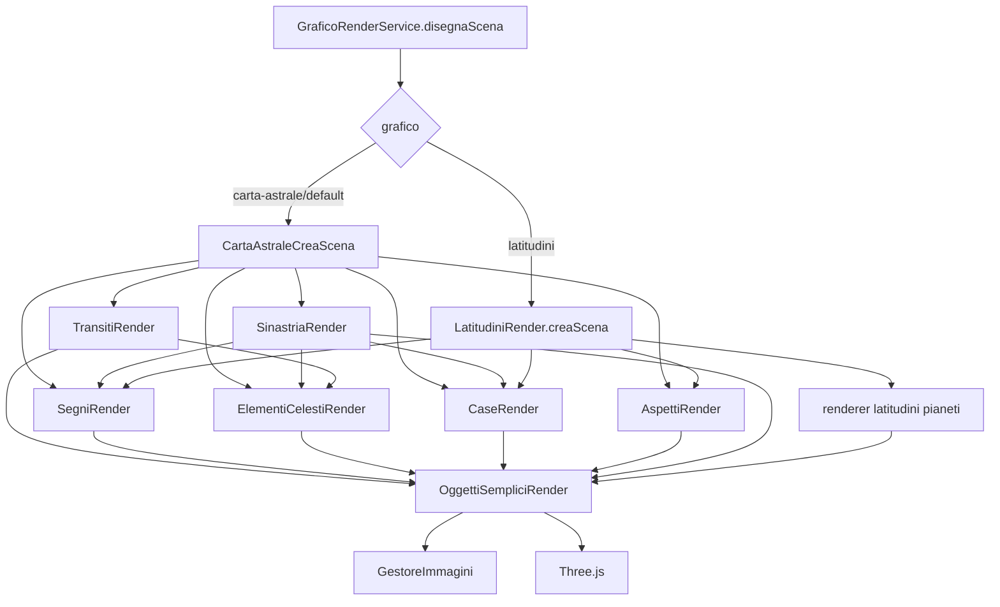

# `grafici-astrologici` — reference dei renderer e invarianti geometriche

Ultima revisione: **11 agosto 2026**

Questo documento descrive il comportamento del motore di composizione Three.js a livello di modulo. L'obiettivo è rendere espliciti i contratti che oggi sono incorporati nel codice: ordine di disegno, coordinate, diametri, dipendenze dalle opzioni, asset e casi limite.

Sorgente normativo:

```text
shared/grafici-astrologici/src/lib/renderers/
```

---

# 1. Call graph attivo



La composizione della carta astrale principale avviene in quest'ordine:

```text
1. transiti
2. segni
3. elementi celesti radix
4. case
5. aspetti
6. sinastria
```

L'ordine è significativo per sovrapposizioni, z-position implicite, texture e leggibilità. Modificarlo è una modifica visuale anche se nessun tipo cambia.

---

# 2. Sistema di coordinate

Il grafico è costruito sul piano XY e osservato da una camera posta sull'asse Z.

Nei renderer ricorre l'offset:

```ts
75 - ascendente + 15
```

che equivale numericamente a:

```text
90 - ascendente
```

Il codice conserva però la forma originale in diversi punti; quando si refactora è opportuno mantenere una sola funzione canonica e coprirla con test geometrici.

La regola generale di posizionamento è:

```text
angolo visuale = 90 - ascendente + longitudine + eventuali offset
```

Gli oggetti vengono spesso:

1. ruotati attorno all'origine;
2. traslati lungo Y;
3. riportati con `rotation.z = 0` per mantenere il simbolo diritto.

## Inversione australe

Nel renderer carta astrale:

```ts
if (temaRender.australInversion && !opzioni.mostraSinastria)
  disegno.rotation.y = Math.PI;
```

Quindi l'inversione è applicata all'intero gruppo soltanto quando non è attiva la sinastria.

Nella vista latitudini, invece, l'inversione viene applicata se `temaRender.australInversion`, senza la stessa esclusione per la sinastria.

Questa differenza va considerata un contratto storico finché non viene deliberatamente uniformata.

---

# 3. `CartaAstraleCreaScena`

File:

```text
renderers/@carta-astrale/carta-astrale.renderer.ts
```

## API

```ts
export async function CartaAstraleCreaScena(
  opzioni,
  temaRender,
  temaRenderTransiti,
  temaRenderSinastria
): Promise<THREE.Group | null>
```

## Stato di composizione

`creaStatoCartaAstrale()` prepara un `StatoCartaAstrale` contenente:

```text
opzioni
radix
transiti
sinastria
tema direzione opzionale
diametri
scale simboli
asc/mc radix
asc/mc sinastria
flag uso forzato assi
flag calcolo parti arabe
riferimenti ai gruppi renderizzati
```

### Swap dei temi

Se:

```text
mostraSinastria = true
sinastria.invertiTemi = true
```

radix e sinastria vengono scambiati nello stato prima del calcolo geometrico.

### Uso forzato degli assi

`forzaUsaAssiInElementiCelesti` viene attivato se sono attivi transiti o direzioni.

### Parti arabe

`calcolaPartiArabe` diventa `true` soltanto quando la modalità scelta dispone dei parametri minimi richiesti:

- `crea`: destinazione + corpo sorgente esistente;
- `abumashar`: formula + casa selezionata;
- `essenziali`: formula selezionata.

---

# 4. Geometria base e diametri

La carta non usa pixel assoluti per gli anelli: usa diametri Three.js derivati da un diametro base e da rapporti storici rispetto a `120`.

## Diametro base dell'anello zodiacale

```text
senza transiti: 4.5723
con transiti:    3.7355
```

Modalità transiti sinodici, quando il payload contiene `transitiSinodici`:

```text
diametro anello segni = 1.4
scale segni = 0.4
scale pianeti = 0.4
scale case = 0.4
```

## Rapporti principali

I seguenti valori vengono moltiplicati per il diametro dell'anello segni:

| Diametro | Rapporto |
|---|---:|
| anello transiti sinodici | `440 / 120` |
| ultima orbita transiti sinodici | `412.5 / 120` |
| assi transiti | `152.64 / 120` |
| anello stelle fisse | `146.64 / 120` |
| anello transiti | `146.64 / 120` |
| assi | `138 / 120` |
| griglia transiti | `120 / 120` |
| anello elementi celesti | `95.82 / 120` |
| cerchio dodecatemori | `91.66 / 120` |
| cerchio dodecatemori 2 | `87.5 / 120` |
| interno mini arco case | `75.1 / 120` |
| anello case | `74.16 / 120` |
| cerchio interno termini | `70.03 / 120` |
| interno anello case | `63.36 / 120` |

Questi rapporti sono **invarianti visuali storiche**, non semplici numeri di layout. Vanno spostati in una configurazione nominata prima di modificarli.

## Variazioni principali

### Direzioni primarie semplificate / simboliche

Se è disponibile un tema secondario o una lunazione ermetica:

- l'anello case viene ristretto;
- il bordo interno viene ulteriormente ridotto;
- la scala dei simboli case passa a circa `0.5`.

### Transiti sinodici con sinastria radix

- anello case: `39.03 / 120` del base;
- interno case: `28.23 / 120`;
- scala case: `0.7`;
- scala elementi celesti: `0.7`.

### Chakram

Se attivi:

```text
diametroCerchioAspetti = diametroInternoAnelloCase * sqrt(2) / 2
```

altrimenti coincide con il bordo interno delle case.

### Sinastria

- disabilita il diametro interno termini;
- scala case `0.7`;
- interno case `68.76 / 120`;
- cerchio aspetti `37 / 120`;
- definisce diametri separati per case, elementi e segni del secondo tema.

### Tema senza case

Se il radix non ha `houses` e non è sinastria, il cerchio aspetti usa il diametro del mini arco case. Inoltre il bordo interno delle case viene riallineato all'anello case quando non esistono case o quando si mostrano effemeridi grafiche.

---

# 5. `aggiornaModuli()` e riferimenti ai gruppi

L'orchestratore usa il nome della funzione per derivare dinamicamente il campo del gruppo:

```ts
const nomeGruppo = 'gruppo' + modulo.name.replace('crea', '');
```

Esempi:

```text
creaSegni            -> gruppoSegni
creaCase             -> gruppoCase
creaElementiCelesti  -> gruppoElementiCelesti
creaAspetti          -> gruppoAspetti
creaTransiti         -> gruppoTransiti
creaSinastria        -> gruppoSinastria atteso
```

Il codice corrente di `creaSinastria()` salva però il gruppo in:

```ts
stato.gruppoTransiti = group
```

anziché `gruppoSinastria`. È un difetto strutturale già registrato in `KNOWN_ISSUES.md`.

---

# 6. `SegniRender`

File:

```text
renderers/moduli/segni.renderer.ts
```

## API interna principale

```ts
getAnelloSegni(
  asc,
  simboliScale,
  diametroInterno,
  diametroEsterno,
  australInversion,
  mostraDecani,
  mostraDecadi,
  opzioni
)
```

## Composizione

1. calcola offset ascendente;
2. legge `SkinManager.skins[skin_id].anelloSegni`;
3. crea texture di settore oppure cerchio esterno;
4. crea tacche ogni 5°;
5. carica i 12 simboli zodiacali;
6. opzionalmente aggiunge decani;
7. opzionalmente aggiunge decadi.

## Tacche

Ci sono 72 posizioni da 5°:

- multipli di 30° → linea che attraversa tutta la fascia;
- multipli di 10° → lunghezza `0.1`;
- restanti multipli di 5° → lunghezza `0.05`.

## Asset segni

```text
simboli-bianchi/segni/01.png
...
simboli-bianchi/segni/12.png
```

Il colore può essere fisso oppure derivato da `skin.elementi[i % 4]` quando `coloreSimboli == 'elementi'`.

## Decani

Sequenza planetaria:

```text
Mars -> Sun -> Venus -> Mercury -> Moon -> Saturn -> Jupiter -> repeat
```

`getDecani()` divide lo zodiaco in 36 settori da 10° e aggiunge il simbolo del governatore.

## Decadi

`getDecadi()` dispone simboli zodiacali nelle tre divisioni da 10° di ogni segno. Nomenclatura e commenti nel file non sono perfettamente allineati: evitare di dedurre il significato solo dal commento.

## Sinastria

`getAnelloSegniSinastria()` usa simboli più piccoli e una versione semplificata delle divisioni.

## Debito tecnico specifico

- importa `StatoCartaAstrale` dal package root invece che relativamente;
- contiene `console.log('asd')` quando la skin non usa texture;
- `mostraDecani` e `mostraDecadi` non sono dichiarati nel tipo pubblico `OpzioniGrafico`.

---

# 7. `CaseRender`

File:

```text
renderers/moduli/case.renderer.ts
```

## Entry point carta astrale

```ts
getAnelloCaseCartaAstrale(
  casePos,
  degOffs,
  simboliScale,
  imgRef,
  opzioni,
  diametroInterno,
  diametroInternoMiniArcoCase,
  diametroEsterno,
  diametroCerchioInternoTermini,
  australInversion,
  isCaseSinastria = false
)
```

## Schema `casePos`

La modalità standard richiede:

```ts
casePos[domificazione] = {
  ascendant: number,
  mc: number,
  house: number[12]
}
```

## Normalizzazione delle cuspidi

`renderAnelloCase()` costruisce una sequenza monotona:

```text
house[0]
house[1] oppure house[1] + 360 se retrocede rispetto alla precedente
...
```

Questo consente di calcolare correttamente il punto mediano di ogni casa anche attraverso 0° Ariete.

## Offset

Linee e simboli usano:

```text
-caseObj.ascendant + 90 + degOffs
```

Le texture usano un offset storico differente di 90°:

```text
-caseObj.ascendant + degOffs + 180
```

## Simboli delle case

Asset:

```text
simboli-bianchi/case/01.png
...
simboli-bianchi/case/12.png
```

Ogni numero viene posizionato al centro angolare tra la cuspide corrente e la successiva.

## Termini

Sono mostrati soltanto se:

```text
mostraTermini = true
AND domificazione in {egizia, egiziaplacido}
AND diametroCerchioInternoTermini != false
```

`renderTermini()` disegna 5 simboli per ciascun segno usando la cartella:

```text
simboli/elementi/<skin>/875x605/
```

## `egiziaplacido`

Esiste un ramo speciale che compone un anello Placido interno e un secondo livello esterno. La modalità è però commentata nel catalogo pubblico delle domificazioni: è funzionalità dormiente/parzialmente raggiungibile.

## Sinastria

`renderAnelloCaseSinastria()` usa eventuali override:

```text
skin.anelloCase.sinastria
```

con fallback ai valori della skin radix.

## Latitudini

`getAnelloCaseLatitudini()` delega a una rappresentazione specifica della vista latitudinale sul sistema di domificazione selezionato.

---

# 8. `ElementiCelestiRender`

File:

```text
renderers/moduli/elementi-celesti.renderer.ts
```

È il modulo più complesso e più accoppiato della libreria.

## Entry point

```ts
getAnelloElementiCelesti(
  temaRender,
  ascendente,
  pianetiDaColorare,
  simboliScale,
  opzioni,
  eventiMouse,
  eventiMouseDodecatemori,
  diametroCerchioInterno,
  diametroCerchioEsterno,
  diametroCerchioDodecatemori,
  lineaSuCerchioEsterno,
  australInversion,
  parametroDiRender = 'longitude',
  usaAssi = true,
  calcolaPartiArabe = false,
  degOffs = 0,
  offsDirezioniSemplificate = 0,
  offsDirezioniSemplificateFasullo = 0,
  isCerchiaLaLuna = false,
  isElementiSinastria = false
)
```

La quantità di parametri posizionali rende facile scambiare semanticamente gli argomenti. È una delle prime API interne da convertire a options object.

## Selezione degli elementi

`getElementiCelesti()` parte da una copia JSON di `temaRender.planets` e costruisce l'insieme da rendere in base a:

- `settaggi.elementi_celesti[nome].att`;
- selezione specifica delle effemeridi grafiche;
- modalità kleros;
- assi AS/DS/MC/IC;
- Vertex;
- eventuale inclusione dei trans-saturnini se congiunti;
- esclusione successiva degli assi quando non richiesti;
- trasformazioni delle direzioni;
- trasformazioni delle parti arabe.

### Assi sintetici

AS, DS, MC e IC vengono creati con `initElementoCeleste()` a partire dalle case selezionate.

### Drift `transaturnini`

Il renderer legge:

```text
settaggi.transaturniniSeCongiunti
```

mentre modello, API centrale e default usano:

```text
transaturnini_se_congiunti
```

Nel flusso standard web l'API centrale restituisce il nome snake_case. Questo va normalizzato prima di fare affidamento sulla funzione.

## Collision avoidance dei simboli

`offsetMinimoPianeti` vale:

```text
7°
```

`getRenderPosPianeti()`:

1. converte gli elementi in array `{ key, deg }`;
2. ordina per grado;
3. applica `ciclo()` due volte;
4. ogni ciclo sposta in avanti un pianeta quando il gap col precedente è < 7°;
5. ruota poi i valori di 180° modulo 360;
6. ricostruisce un oggetto indicizzato per nome.

Questo algoritmo separa la **posizione grafica del simbolo** dalla longitudine reale usata dalle linee radiali.

Una modifica al collision avoidance può quindi cambiare fortemente il layout pur lasciando invariati i dati astrologici.

## Asset diretti/retrogradi

```text
longitudeSpeed < 0
  -> simboli-bianchi/elementi-celesti/<nome>-r.png
else
  -> simboli-bianchi/elementi-celesti/<nome>.png
```

## Parti arabe

In modalità `crea` il renderer calcola un offset fra destinazione e corpo scelto e trasla le longitudini dei pianeti copiati.

Nelle modalità `essenziali` / `abumashar` legge una formula già presente in `temaRender.partiArabe`, applica `lngOffs` e può:

- evidenziare un pianeta;
- ridurre l'opacità degli altri;
- disegnare una freccia ad arco;
- avviare una animazione GSAP continua.

## Dodecatemori

Supporta almeno:

```text
dodecatemore = 'tutti'
dodecatemore = <nome corpo>
```

Il singolo elemento selezionato può essere animato con una timeline GSAP infinita.

## Kleros

Il renderer riconosce anche valori non inclusi nel tipo pubblico:

```text
estrapola-tutto
estrapola-4luminarie
estrapola-5planetarie
visualizza sorti
```

## Eventi mouse

I parametri relativi agli eventi sono ancora presenti, ma l'integrazione con `GestoreEventiMouse` è commentata.

---

# 9. `AspettiRender`

File:

```text
renderers/moduli/aspetti.renderer.ts
```

Questo modulo **calcola** anche quali aspetti disegnare; non si limita a visualizzare un elenco prodotto dal backend.

## Pipeline

```text
getAspettiVerso(opzioni)
  -> getTipiAspetti(opzioni)
  -> ElementiCelestiRender.getElementiCelesti(...)
  -> getNodi(...)
  -> getArchi(...) / getArchiDoppioTema(...)
  -> renderArchi(...)
  -> getBackgroundAspetti(...)
```

## Corpi verso cui calcolare aspetti

`getAspettiVerso()` include solo gli elementi con:

```text
settaggi.elementi_celesti[nome].aspVerso == true
```

## Tipi attivi

`getTipiAspetti()` legge `settaggi.aspetti_attivi`.

## Nodo visuale

`getNodi()` produce concettualmente:

```ts
{
  name,
  longitude,
  orb,
  y,
  declinazione?
}
```

La declinazione deriva da:

```text
elemento.equatoriale.declination
```

Può essere aggiunto anche un nodo `<nome>-dodecatemoria`.

## Orbite

Per una coppia viene usata l'orbita del nodo di destinazione, eventualmente limitata da:

```text
settaggi.aspetti_orbite[tipo]
```

quando l'override esiste ed è più piccolo.

## Aspetti longitudinali

Il confronto considera equivalenze ± angolo e wrap a 360°.

Phi solare e phi lunare vengono trattati come direzionali in un ramo dedicato.

## Paralleli di declinazione

```text
parallelodideclinazione: |decl1 - decl2| < circa 1°
antiparallelo:           |decl1 + decl2| < circa 1°
```

## Esclusioni

Sono filtrate alcune coppie meccaniche che non devono apparire come aspetti, fra cui:

- combinazioni fra assi opposti/ortogonali;
- apogeo e perigeo della stessa famiglia;
- nodo nord e nodo sud della stessa famiglia.

## Stili linea

### Linea continua

```text
congiunzione
semisestile
sestile
quadrato
trigono
opposizione
novile
settile
```

### Tratteggiata

```text
semiquadrato
```

### Punto-linea

```text
quinconce
quintile
biquintile
semiquintile
parallelodideclinazione
antiparallelo
phisolare
philunare
```

Ogni variante usa parametri propri di passo e rapporto linea/spazio.

## Colori

Base:

```text
Colori.aspetti[tipo]
```

Può essere sostituita da:

- `monocoloreLineeAspetti` della skin;
- colore scuro quando sono attivi antisci;
- dimming per focus su un singolo corpo;
- dimming nelle modalità kleros.

## Background aspetti

`getBackgroundAspetti()` aggiunge:

1. settore circolare/texture della skin;
2. risuonatore solare con immagine, scala, colore e opacità configurati dalla skin.

---

# 10. `TransitiRender`

File:

```text
renderers/moduli/transiti.renderer.ts
```

## Attivazione dall'orchestratore

Il modulo viene creato se:

```text
mostraTransiti
AND temaRenderTransiti presente
AND NOT (mostraTransitiSinodici AND transitoSinodicoSinastriaConRadix)
```

## `getAnelloTransiti()`

- legge `skin.anelloTransiti`;
- può disegnare una texture di fondo dell'anello;
- delega i simboli a `ElementiCelestiRender`;
- non disegna attualmente gli assi dei transiti perché il relativo blocco è commentato;
- opzionalmente aggiunge antisci.

## Antisci

Assi codificati:

```text
Cardinale = 270°
Fissa     = 300°
Mutevole  = 330°
```

Con `antisciTransitiHover` calcola:

```text
antiscia       = 2 * asse - longitudine
controantiscia = antiscia + 180°
```

poi disegna punti e linee di collegamento.

---

# 11. `SinastriaRender`

File:

```text
renderers/moduli/sinastria.renderer.ts
```

## API

```ts
getAnelloSinastria(
  temaRender,
  ascendenteTemaDiRiferimento,
  pianetiDaColorare,
  stato,
  diametroAssi,
  diametroCerchioAspetti,
  diametroAnelloSegni,
  diametroAnelloElementiCelesti,
  diametroInternoMiniArcoCase,
  diametroAnelloCase
)
```

## Composizione

Se il secondo tema ha case:

1. legge il suo ascendente;
2. ruota l'anello case per allinearlo al tema di riferimento;
3. usa `CaseRender` con `isCaseSinastria = true`.

Se non ha case, può usare un fallback di texture dell'anello.

Poi aggiunge:

```text
ElementiCelestiRender in modalità sinastria
SegniRender.getAnelloSegniSinastria
CaseRender se disponibile
```

## Deflettiva

Le variabili e l'opzione esistono, ma la logica principale della sinastria deflettiva è oggi in gran parte commentata. Non va considerata una feature stabile senza un test end-to-end dedicato.

## Direzioni / Luna cerchiata

Quando:

```text
direzioniModalita == 'temaProgresso'
AND mostraDirezioni
```

il renderer secondario chiede a `ElementiCelestiRender` di cerchiare la Luna.

---

# 12. `LatitudiniRender`

File:

```text
renderers/@carta-astrale/latitudini.renderer.ts
```

È una pipeline distinta dalla carta radiale, non un semplice flag della stessa scena.

## Stato

Usa un singleton statico:

```ts
LatitudiniRender.lr
```

## Diametri fissi

Base:

```text
anello segni = 4.6
```

Derivati:

```text
assi                    = 4.6 * 138 / 120
anello elementi celesti = 4.6 * 95.82 / 120
eclittica               = 4.6 * 52.62 / 120
risuonatore solare      = 4.6 * 9.42 / 120
```

## Composizione

1. se esistono case: anello case latitudini;
2. background/risuonatore degli aspetti al centro;
3. anello zodiacale;
4. griglia e corpi radix;
5. eventuali corpi dei transiti;
6. inversione australe del gruppo.

Il parametro `temaRenderSinastria` ricevuto da `creaScena()` non viene usato nel flusso attivo.

## Selezione corpi

La condizione corrente richiede:

```ts
temaRender.planets[nome]
&& temaRender.planets[nome].latitude
&& elOpt.att
```

Poiché `0` è falsy, una latitudine esattamente `0°` viene esclusa. Il test corretto futuro deve verificare `latitude != null` / `Number.isFinite`.

## Mappatura latitudine → raggio

La latitudine viene limitata a:

```text
[-9°, +9°]
```

e trasformata linearmente in una posizione radiale rispetto all'eclittica.

## Indicatore di moto latitudinale

La direzione usa:

```text
Math.sign(latitudeSpeed)
```

per disegnare un breve tratto radiale.

## Asset legacy-specifici

La vista costruisce percorsi usando `opzioni.temaGrafico`:

```text
simboli/elementi-celesti/<temaGrafico>/cerchio/<nome>.png
simboli/elementi-celesti/<temaGrafico>/cerchio/anello/<nome>.png
```

Questo differisce dalla pipeline principale, che si appoggia maggiormente a `skin_id` e ai simboli bianchi colorabili.

---

# 13. `OggettiSempliciRender`: layer geometrico

Tutti i moduli dipendono da questa factory statica.

## Primitive e costo

Ogni chiamata può creare nuovi:

```text
RingGeometry
ShapeGeometry
PlaneGeometry
BufferGeometry / LineGeometry
MeshBasicMaterial
LineMaterial
Texture
Mesh / Line2 / Group
```

Non esiste un pool centralizzato per geometrie/materiali.

## Linee `Line2`

La larghezza è in pixel e dipende da:

```text
canvasWidth / baseWidth * lineScaleFactorMultiplier
```

con:

```text
baseWidth = 1300
```

Per l'Astrolabio headless il moltiplicatore viene modificato in base al display, quindi questo stato statico è parte del contratto dispositivo.

## Risoluzione `LineMaterial`

Il servizio Angular attraversa la scena dopo resize per aggiornare `material.resolution` delle linee spesse. Un consumer low-level deve gestire autonomamente la risoluzione corretta o costruire le linee dopo aver impostato le dimensioni globali.

## Arc texture

`getSemiArcoGrosso()`:

- crea due `EllipseCurve`;
- concatena arco interno + esterno invertito;
- costruisce una `ShapeGeometry`;
- ricalcola UV dal bounding box;
- applica texture con clamp e filtri lineari.

È il meccanismo base delle fasce texturizzate di segni, case, aspetti e transiti.

---

# 14. Asset resolution effettiva

La pipeline principale passa spesso riferimenti come:

```text
simboli-bianchi/...
```

`OggettiSempliciRender.getMaterial()` li trasforma in:

```text
../../../assets/img/<ref>
```

e poi chiama `GestoreImmagini.loadAsync()`.

Altri punti passano direttamente:

```text
assets/img/...
/assets/img/...
```

oppure percorsi specifici delle skin.

Quindi oggi non esiste un singolo namespace canonico degli asset.

L'Astrolabio headless risolve questo problema con un adapter che normalizza i path e sostituisce a runtime `GestoreImmagini.getImg/loadAsync`.

---

# 15. Z-order e profondità

Non esiste un registro unico degli z-index. I moduli usano piccoli `position.z` locali, ad esempio valori come:

```text
-0.0009
-0.001
-0.002
+0.01
```

per evitare z-fighting e controllare la sovrapposizione.

Questi valori vanno considerati parte dell'output visuale. Prima di semplificarli occorre confrontare snapshot con:

- texture attive;
- inversione australe;
- transiti;
- sinastria;
- risuonatore solare.

---

# 16. Side effect e stato globale

## `GraficoRenderService`

Singleton Angular con una sola scena/renderer principale.

## `OggettiSempliciRender`

Stato statico globale per dimensioni e scala linee.

## `LatitudiniRender`

Singleton statico interno.

## `GestoreImmagini`

`assetsBase` e pool texture statici.

## GSAP

`ElementiCelestiRender` può creare timeline infinite non registrate nel `StatoCartaAstrale`.

Conseguenza: il core non è oggi re-entrant né progettato per render paralleli indipendenti.

---

# 17. Invarianti da preservare durante refactor

Prima di considerare equivalente un nuovo renderer devono restare invariati, salvo modifica intenzionale:

1. orientamento rispetto all'ascendente;
2. ordine dei moduli;
3. rapporti fra diametri;
4. posizione vera delle linee vs posizione separata dei simboli;
5. midpoint delle case attraverso 0°;
6. selezione dei corpi attivi;
7. applicazione delle orbite;
8. esclusioni delle coppie speciali negli aspetti;
9. inversione australe;
10. fallback dei temi senza case;
11. differenze radix/transiti/sinastria;
12. scala delle linee per dimensione canvas/display;
13. risoluzione e colorazione delle texture;
14. asset direct/retrograde;
15. z-order dei layer.

---

# 18. Fixture minime per test geometrici

Una suite robusta dovrebbe avere fixture deterministicamente versionate per:

```text
F01 radix completo Placido
F02 radix completo Egizia
F03 tema senza orario / houses vuote
F04 pianeti molto ravvicinati (< 7°)
F05 pianeta esattamente a 0° longitudine
F06 latitudine esattamente 0°
F07 transiti completi
F08 radix + sinastria entrambi con case
F09 sinastria senza case
F10 inversione australe
F11 aspetti di declinazione
F12 dodecatemore singolo e tutti
F13 termini
F14 parti arabe essenziali
F15 parti arabe Abu Ma'shar
F16 kleros
F17 direzioni
F18 ogni skin
```

Per ogni fixture salvare almeno:

```text
input TemaRender
opzioni
skin
THREE.Group invariants
snapshot PNG browser
snapshot PNG headless quando applicabile
```

---

# 19. Priorità di refactoring del renderer

Ordine consigliato che minimizza il rischio:

1. introdurre test geometrici e visuali sulle invarianti sopra;
2. tipizzare `TemaRender` e `OpzioniGrafico` senza cambiare comportamento;
3. convertire `getAnelloElementiCelesti()` a options object;
4. isolare funzioni pure: offset, diametri, cuspidi, collision avoidance, aspetti;
5. introdurre `ChartRenderSession` per eliminare stato statico condiviso;
6. introdurre asset resolver;
7. introdurre disposal ricorsivo e texture registry;
8. separare calcolo aspetti dal rendering;
9. uniformare carta astrale e latitudini;
10. soltanto dopo migrare/rimuovere i renderer legacy.
